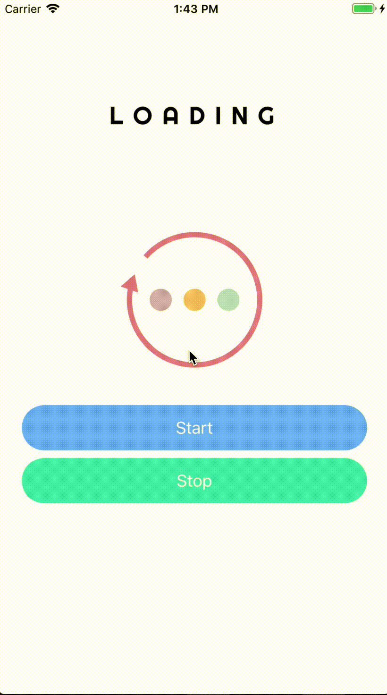

# Elephant

Animated SVGs for iOS, in SwiftUI and UIKit. Elephant renders bundled or local SVG files using `WKWebView`. It can control animations defined inside the SVG or in a separate CSS file.

[](https://github.com/s2mr/Elephant/releases/latest)
[](https://cocoapods.org/pods/Elephant)
[](#requirements)
[](LICENSE)

<p align="center">
  
</p>

## Installation

### Swift Package Manager

In Xcode, choose **File → Add Package Dependencies** and enter `https://github.com/s2mr/Elephant.git`. Add the **Elephant** product to your iOS app target.

If you use a `Package.swift` manifest, add Elephant to the package dependencies:

```swift
.package(url: "https://github.com/s2mr/Elephant.git", from: "0.3.0")
```

Then add `.product(name: "Elephant", package: "Elephant")` to your target's dependencies.

### CocoaPods

```ruby
pod 'Elephant', '~> 0.3.0'
```

Run `pod install` and open the generated workspace.

## Quick start

Add `image.svg` to your app target's **Copy Bundle Resources**. Pass the filename without the extension. Use `.svg` when the SVG itself defines the animation.

### SwiftUI

```swift
import SwiftUI
import Elephant

struct ContentView: View {
    @StateObject private var animation = AnimatedSVGViewController()

    var body: some View {
        VStack {
            AnimatedSVGView(named: "image", animationOwner: .svg, controller: animation)
                .frame(width: 240, height: 240)

            HStack {
                Button("Play") { animation.startAnimation() }
                Button("Pause") { animation.stopAnimation() }
            }
        }
    }
}
```

### UIKit

`SVGView` has a failable initializer. Check that the resource loaded before adding the view to your hierarchy.

```swift
import UIKit
import Elephant

final class ViewController: UIViewController {
    override func viewDidLoad() {
        super.viewDidLoad()

        guard let svgView = SVGView(named: "image", animationOwner: .svg) else { return }
        svgView.translatesAutoresizingMaskIntoConstraints = false
        view.addSubview(svgView)

        NSLayoutConstraint.activate([
            svgView.centerXAnchor.constraint(equalTo: view.centerXAnchor),
            svgView.centerYAnchor.constraint(equalTo: view.centerYAnchor),
            svgView.widthAnchor.constraint(equalToConstant: 240),
            svgView.heightAnchor.constraint(equalToConstant: 240),
        ])
    }
}
```

Call `startAnimation()` or `stopAnimation()` on a mounted view, or on its SwiftUI controller. Web content loads asynchronously, so trigger playback after the SVG is visible rather than immediately after initializing the view. Use `isAnimate(result:)` to query playback state asynchronously.

## SVG and CSS

| Animation source | Configuration |
| --- | --- |
| Inside the SVG | `animationOwner: .svg` |
| External CSS file | `animationOwner: .css, style: .cssFile(name: "loading-text")` |

For CSS animations, include both `loading-text.svg` and `loading-text.css` in your app bundle. Elephant adds an `animation-play-state` rule controlled by a CSS custom property. Avoid overriding it if you want the Play and Pause controls to work. See the [example stylesheet](Examples/iOS/Example-iOS/Resources/loading-text.css).

Both views also have a `fileURL:` initializer for a local SVG file. For resources in a bundle other than the app's main bundle, pass `bundle:` to the named view initializer and to `.cssFile(name:bundle:)` if needed.

## Example app

Open [`Examples/iOS/Example-iOS.xcodeproj`](Examples/iOS/Example-iOS.xcodeproj), select the **Example-iOS** scheme, and run it on an iOS simulator. The project includes [UIKit](Examples/iOS/Example-iOS/ViewController.swift) and [SwiftUI](Examples/iOS/Example-iOS/SwiftUIExampleView.swift) examples and [sample assets](Examples/iOS/Example-iOS/Resources).

## Requirements

- iOS 14 or later.
- Swift tools 6.0 or later for Swift Package Manager.
- The repository pins Xcode 26.4 for local development.

## Author

[Kazumasa Shimomura](https://github.com/s2mr)

## License

Apache License 2.0. See [LICENSE](LICENSE).

## Star history

<a href="https://www.star-history.com/#s2mr/Elephant&Date">
  <picture>
    <source media="(prefers-color-scheme: dark)" srcset="https://api.star-history.com/svg?repos=s2mr/Elephant&type=Date&theme=dark">
    
  </picture>
</a>
